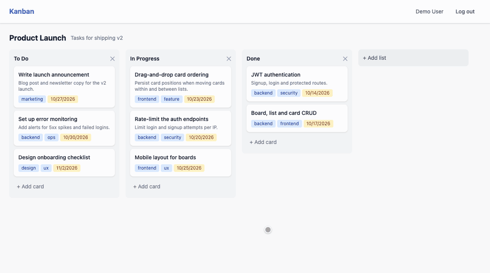
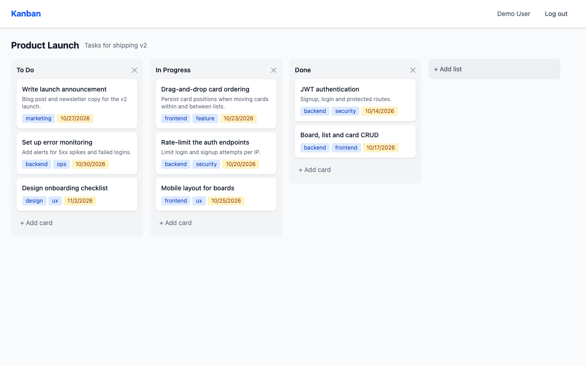
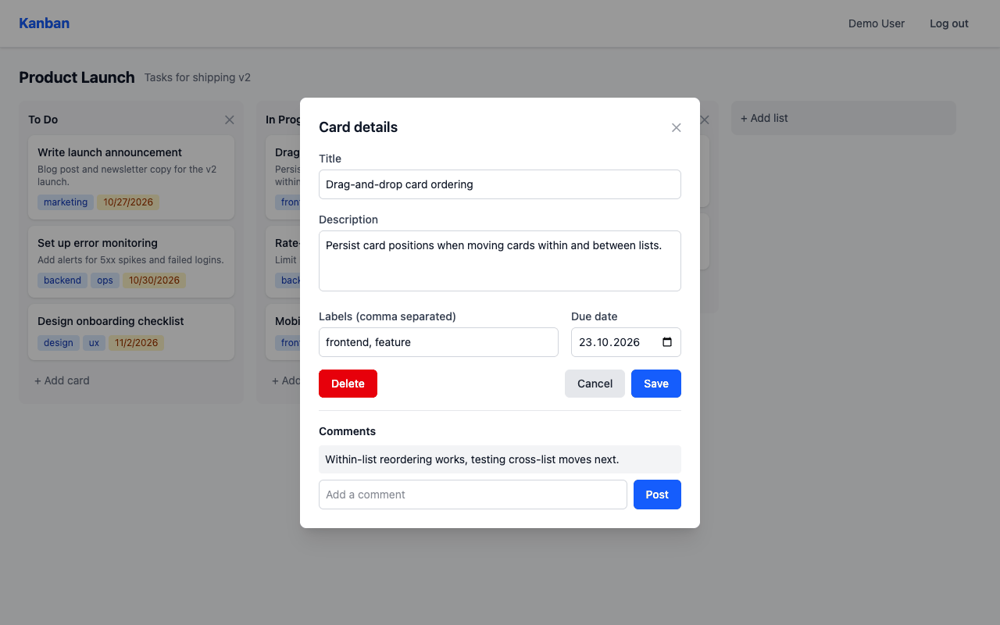
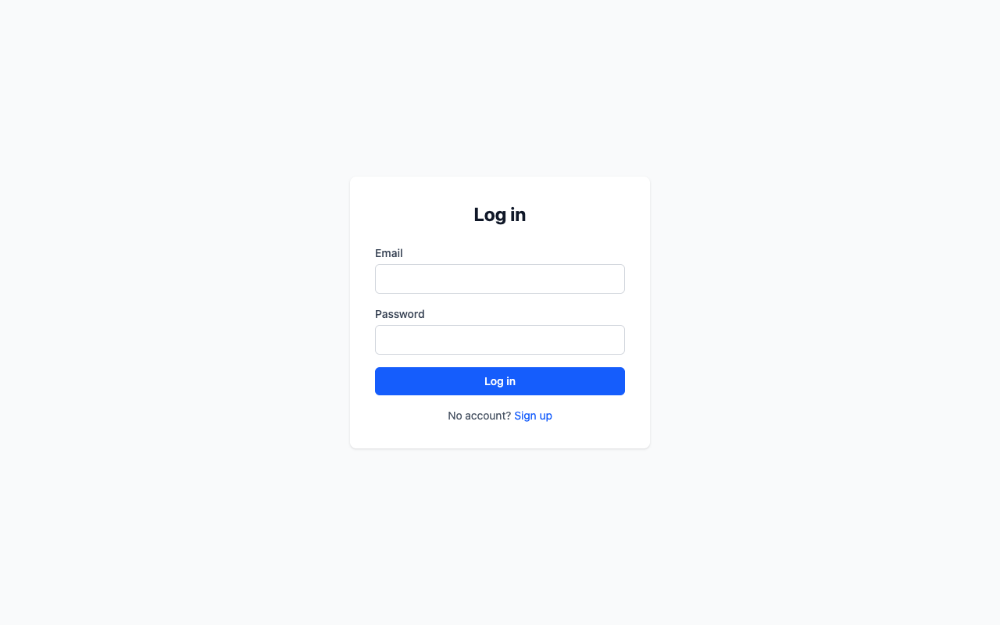

# Kanban Task Manager

[](https://github.com/nurlanmusayev2000/kanban-task-manager/actions/workflows/ci.yml)

A full-stack Kanban board built with MongoDB, Express, React and Node.js (MERN), in TypeScript. Users sign up, create boards, and drag cards between lists. Card order is saved on the server.



| Board | Card detail | Login |
| --- | --- | --- |
|  |  |  |

## Features

- **Accounts:** sign up and log in with JWT authentication. Passwords are hashed with bcrypt.
- **Boards:** create colour-coded boards. Only the owner and members can open a board.
- **Lists:** add lists, rename them inline, and delete them along with their cards.
- **Cards:** create, edit and delete cards with a description, labels and a due date, and add comments.
- **Drag and drop:** move cards within a list or between lists. The card moves immediately, the new order is saved on the server, and the move is undone if saving fails.
- **No-install demo:** `npm run dev:memory` runs the API on an in-memory MongoDB, preloaded with a demo board.

## Tech stack

| Area | Library | Version |
| --- | --- | --- |
| UI | React | 19.3 |
| State and data fetching | Redux Toolkit, RTK Query, React Redux | 2.12, 9.3 |
| Drag and drop | dnd-kit (core, sortable) | 6.3, 10.0 |
| Routing | React Router | 7.18 |
| Forms | React Hook Form | 7.88 |
| Styling | Tailwind CSS | 4.3 |
| Frontend build | Vite, TypeScript | 8.3, 6.0 |
| API | Express | 5.2 |
| Database | MongoDB with Mongoose | Mongoose 9.10 |
| Auth | jsonwebtoken, bcryptjs | 9.0, 3.0 |
| Backend tooling | TypeScript, tsx | 7.0, 4.23 |
| Dev database | mongodb-memory-server | 11.3 |

## Architecture

A request flows like this:

```
React component → RTK Query hook (adds the Bearer token) → Express route
  → auth middleware (verifies the JWT) → controller (checks board access) → Mongoose → MongoDB
```

### JWT authentication

1. `POST /api/auth/signup` or `/login` checks the credentials. Passwords are hashed by a Mongoose pre-save hook and compared with `bcrypt.compare`.
2. The server signs a JWT containing `{ userId, email }`. It expires after `JWT_EXPIRE`, which defaults to 7 days.
3. The frontend's `authSlice` stores the token and user in Redux and in localStorage, so the session survives a reload. `ProtectedRoute` sends signed-out users to `/login`.
4. RTK Query's `prepareHeaders` adds `Authorization: Bearer <token>` to every request.
5. On the server, the `auth` middleware verifies the token and sets `req.user`. Board, list and card controllers then call `requireBoardAccess`, which returns 403 unless the user owns the board or is a member.

Tokens are stateless, so logging out simply discards the token in the browser. Keeping the token in localStorage keeps the app simple, but any script running on the page can read it. Storing it in an httpOnly cookie would protect it from XSS.

### API and RTK Query

All endpoints are defined in one RTK Query API slice, `frontend/src/services/api/apiSlice.ts`. Two kinds of cache tags keep the UI in sync:

- **`Board`:** the board list on the dashboard. Creating a board invalidates it.
- **`BoardDetail` (one per board):** `GET /api/boards/:id` returns the board with its lists, and each list's cards, in a single response. Every list and card change invalidates that board's tag, so the board refetches and stays consistent with the server.

### Drag and drop and card order

Each card has a `position`, and the cards in a list are always numbered 0 to n-1.

1. **Dragging:** the board is a dnd-kit `DndContext`. Each list is a droppable `SortableContext`, and each card is a sortable item. A drag starts only after the pointer moves 5 px, so a plain click still opens the card. A `DragOverlay` shows a floating copy of the card that follows the pointer across lists.
2. **Dropping:** `onDragEnd` works out the target list and index. Dropping on a card means that card's index; dropping on an empty part of a list means the end. It then calls `PUT /api/cards/:id` with `{ listId, position }`.
3. **Optimistic update:** the mutation's `onQueryStarted` moves the card in the cached board straight away, using the same rule as the server, so the card doesn't jump back while the request is in flight. If the request fails, the change is undone.
4. **On the server:** `placeCard` in `backend/src/utils/positions.ts` inserts the card at the requested index, clamped to the list's length. It renumbers the target list, and on a move between lists the source list too, in one `bulkWrite`. Deleting a card or list renumbers what's left, so positions never collide.
5. **Sync:** the mutation invalidates the board's tag, and the refetch confirms the server's order.

### Folder structure

```
backend/src/
├── app.ts            # Express app: middleware and routes
├── server.ts         # Connects to MONGODB_URI and starts listening
├── dev/memoryServer.ts  # npm run dev:memory: in-memory MongoDB + demo data
├── config/           # Environment variables, database connection
├── controllers/      # Auth, boards, lists, cards
├── middleware/       # JWT auth, error handling
├── models/           # User, Board, List, Card (Mongoose)
├── routes/
├── seed/demoData.ts  # Demo user and board
├── scripts/seed.ts   # npm run seed
└── utils/            # JWT helpers, async handler, card/list positions

frontend/src/
├── app/              # Redux store and typed hooks
├── services/api/     # RTK Query API slice
├── store/slices/     # authSlice
├── components/
│   ├── common/       # Button, Input, Modal, Loading
│   ├── layout/       # Header, Layout, ProtectedRoute
│   └── features/     # Board and Kanban components (board, list, card, modals)
├── pages/            # Login, Signup, Dashboard, BoardDetail, NotFound
└── types/
```

## API endpoints

All endpoints except signup, login, logout and health need an `Authorization: Bearer <token>` header.

| Method | Path | Description |
| --- | --- | --- |
| GET | `/api/health` | Health check |
| POST | `/api/auth/signup` | Create an account: `{ name, email, password }` |
| POST | `/api/auth/login` | Log in: `{ email, password }`. Returns `{ token, user }` |
| POST | `/api/auth/logout` | Acknowledge logout; the client discards the token |
| GET | `/api/auth/me` | Current user |
| PUT | `/api/auth/profile` | Update `{ name, avatar }` |
| GET | `/api/boards` | Boards you own or are a member of |
| POST | `/api/boards` | Create a board: `{ title, description?, color? }` |
| GET | `/api/boards/:id` | A board with its lists, and each list's cards |
| PUT | `/api/boards/:id` | Update `{ title, description, color, members }` |
| DELETE | `/api/boards/:id` | Delete a board with its lists and cards (owner only) |
| POST | `/api/lists` | Create a list: `{ boardId, title }` |
| PUT | `/api/lists/:id` | Rename a list: `{ title }` |
| DELETE | `/api/lists/:id` | Delete a list and its cards |
| POST | `/api/cards` | Create a card: `{ listId, title, description?, labels?, dueDate? }` |
| PUT | `/api/cards/:id` | Update a card, or move it with `{ listId, position }` |
| DELETE | `/api/cards/:id` | Delete a card |
| POST | `/api/cards/:id/comments` | Add a comment: `{ text }` |

Errors return `{ message }` with status 400, 401, 403 or 404.

## Running locally

You need Node.js 20.19 or later.

### Quick start, no MongoDB needed

```bash
# Terminal 1: API on http://localhost:5001 with an in-memory MongoDB
cd backend
npm install
npm run dev:memory

# Terminal 2: app on http://localhost:5173
cd frontend
npm install
npm run dev
```

Log in with **demo@example.com** / **demo1234**.

- The first `dev:memory` run downloads a MongoDB binary (about 140 MB) into `node_modules/.cache`.
- Data lives only in memory and resets whenever the API restarts. That includes the restarts `tsx watch` does when you edit backend code.
- Neither app needs a `.env` file in this mode.

### With your own MongoDB

```bash
cd backend
cp .env.example .env   # set MONGODB_URI and JWT_SECRET
npm run seed           # optional: create the demo user and board
npm run dev
```

Then start the frontend as above. `npm run seed` replaces only the demo user's data, so you can run it again at any time.

### Scripts

| Directory | Script | What it does |
| --- | --- | --- |
| `backend` | `npm run dev:memory` | API with an in-memory MongoDB and demo data, restarting on changes |
| `backend` | `npm run dev` | API using `MONGODB_URI`, restarting on changes |
| `backend` | `npm run seed` | Create or reset the demo user and board in `MONGODB_URI` |
| `backend` | `npm run build` / `npm start` | Compile to `dist/` / run the compiled API |
| `backend` | `npm test` | Run the API tests |
| `backend` | `npm run lint` | Run oxlint |
| `frontend` | `npm run dev` | Vite dev server |
| `frontend` | `npm run build` | Type-check, including tests, and build for production |
| `frontend` | `npm test` | Run the component tests |
| `frontend` | `npm run lint` | Run oxlint |

## Testing

Running the tests needs Node.js 22.12 or later.

```bash
cd backend && npm test    # API tests, no MongoDB install needed
cd frontend && npm test   # component tests
```

**Backend:** Vitest and supertest, with mongodb-memory-server. Each test file gets its own in-memory MongoDB, and supertest calls the Express app directly, so no port is opened.

- **Auth:** signup, including duplicate emails and validation, and login. A wrong password and an unknown email return the same 401. Protected routes reject a missing, malformed, expired or forged token.
- **Board access:** another user gets 403 when reading or changing a board, its lists or its cards, and doesn't see the board in their list. Members get access once added, and only the owner can delete a board.
- **Card ordering:** a regression test for the position bug fixed in `81a194a`. After moves within a list, moves between lists and deletes, every list's positions must be exactly 0..n-1 in the expected order. A seeded run of 60 random moves checks the API against a simple model after every step.

**Frontend:** Vitest and React Testing Library in jsdom, with API responses mocked by MSW. Any request a test doesn't mock fails the test.

- **Login form:** required-field errors with no request sent, the server's message for wrong credentials, and a successful login that stores the session and navigates to the dashboard.
- **Board page:** lists and cards are rendered in position order even when the API returns them out of order. The request carries the stored Bearer token, and labels, descriptions and due dates show.

[GitHub Actions](.github/workflows/ci.yml) runs lint, build and tests for both packages on every push and pull request.

## License

[MIT](LICENSE)
